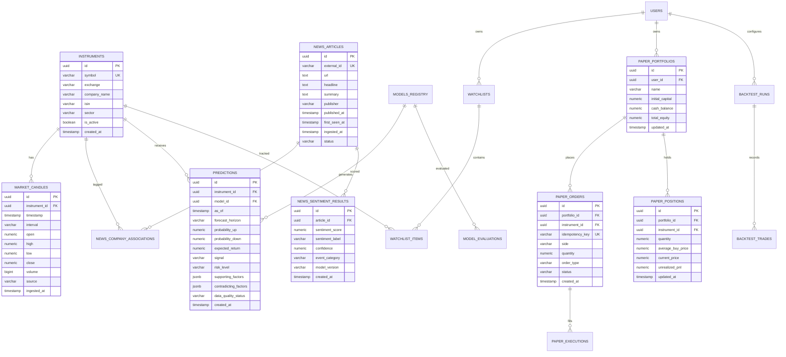

# StockPilot AI — Relational Database Schema & Migrations

StockPilot AI uses **PostgreSQL** (version 15+ / 16+) as its primary relational store. For local development or lightweight testing, SQLAlchemy handles SQLite seamlessly as an in-memory or file-backed fallback.

---

## 1. Entity-Relationship Diagram (ERD)



---

## 2. Table Specifications & Indexing Strategy

### 2.1 Market Data Domain

#### `instruments`
Stores tracked equities on NSE/BSE:
```sql
CREATE TABLE instruments (
    id UUID PRIMARY KEY DEFAULT gen_random_uuid(),
    symbol VARCHAR(32) NOT NULL,
    exchange VARCHAR(16) NOT NULL DEFAULT 'NSE',
    company_name VARCHAR(255) NOT NULL,
    isin VARCHAR(32),
    sector VARCHAR(64),
    lot_size INT NOT NULL DEFAULT 1,
    tick_size NUMERIC(8, 4) NOT NULL DEFAULT 0.05,
    is_active BOOLEAN NOT NULL DEFAULT TRUE,
    created_at TIMESTAMPTZ NOT NULL DEFAULT NOW(),
    updated_at TIMESTAMPTZ NOT NULL DEFAULT NOW(),
    CONSTRAINT uq_instrument_symbol_exchange UNIQUE (symbol, exchange)
);

CREATE INDEX idx_instruments_symbol ON instruments(symbol);
CREATE INDEX idx_instruments_active ON instruments(is_active);
```

#### `market_candles`
Standardized OHLCV time-series:
```sql
CREATE TABLE market_candles (
    id UUID PRIMARY KEY DEFAULT gen_random_uuid(),
    instrument_id UUID NOT NULL REFERENCES instruments(id) ON DELETE CASCADE,
    timestamp TIMESTAMPTZ NOT NULL,
    interval VARCHAR(16) NOT NULL, -- '1d', '5m', '60m'
    open NUMERIC(14, 4) NOT NULL,
    high NUMERIC(14, 4) NOT NULL,
    low NUMERIC(14, 4) NOT NULL,
    close NUMERIC(14, 4) NOT NULL,
    volume BIGINT NOT NULL DEFAULT 0,
    source VARCHAR(32) NOT NULL DEFAULT 'groww',
    ingested_at TIMESTAMPTZ NOT NULL DEFAULT NOW(),
    CONSTRAINT uq_candle_instrument_time_interval UNIQUE (instrument_id, timestamp, interval),
    CONSTRAINT chk_candle_high_low CHECK (high >= low),
    CONSTRAINT chk_candle_high_open CHECK (high >= open),
    CONSTRAINT chk_candle_high_close CHECK (high >= close),
    CONSTRAINT chk_candle_low_open CHECK (low <= open),
    CONSTRAINT chk_candle_low_close CHECK (low <= close)
);

CREATE INDEX idx_candles_inst_time_desc ON market_candles(instrument_id, timestamp DESC);
CREATE INDEX idx_candles_time_interval ON market_candles(timestamp, interval);
```

---

### 2.2 Financial News & Sentiment Domain

#### `news_articles`
```sql
CREATE TABLE news_articles (
    id UUID PRIMARY KEY DEFAULT gen_random_uuid(),
    external_id VARCHAR(255),
    url TEXT NOT NULL,
    headline TEXT NOT NULL,
    summary TEXT,
    publisher VARCHAR(128) NOT NULL,
    source_type VARCHAR(64) NOT NULL, -- 'EXCHANGE_FILING', 'FINANCIAL_NEWS', 'CONCALL'
    published_at TIMESTAMPTZ NOT NULL,
    first_seen_at TIMESTAMPTZ NOT NULL DEFAULT NOW(),
    ingested_at TIMESTAMPTZ NOT NULL DEFAULT NOW(),
    status VARCHAR(32) NOT NULL DEFAULT 'PROCESSED',
    CONSTRAINT uq_news_external_or_url UNIQUE (url)
);

CREATE INDEX idx_news_published_at_desc ON news_articles(published_at DESC);
CREATE INDEX idx_news_first_seen ON news_articles(first_seen_at);
```

#### `news_company_associations`
```sql
CREATE TABLE news_company_associations (
    id UUID PRIMARY KEY DEFAULT gen_random_uuid(),
    article_id UUID NOT NULL REFERENCES news_articles(id) ON DELETE CASCADE,
    instrument_id UUID NOT NULL REFERENCES instruments(id) ON DELETE CASCADE,
    relevance_score NUMERIC(5, 4) NOT NULL DEFAULT 1.0,
    CONSTRAINT uq_news_instrument UNIQUE (article_id, instrument_id)
);

CREATE INDEX idx_news_assoc_instrument ON news_company_associations(instrument_id);
```

#### `news_sentiment_results`
```sql
CREATE TABLE news_sentiment_results (
    id UUID PRIMARY KEY DEFAULT gen_random_uuid(),
    article_id UUID NOT NULL REFERENCES news_articles(id) ON DELETE CASCADE,
    sentiment_score NUMERIC(5, 4) NOT NULL, -- range: -1.0 to +1.0
    sentiment_label VARCHAR(16) NOT NULL,  -- 'POSITIVE', 'NEUTRAL', 'NEGATIVE'
    confidence NUMERIC(5, 4) NOT NULL,
    event_category VARCHAR(64) NOT NULL,   -- 'EARNINGS', 'CONTRACT', 'MANAGEMENT', etc.
    model_version VARCHAR(64) NOT NULL,
    created_at TIMESTAMPTZ NOT NULL DEFAULT NOW()
);

CREATE INDEX idx_sentiment_article ON news_sentiment_results(article_id);
```

---

### 2.3 Machine Learning & Predictions Domain

#### `models_registry`
Tracks all trained model artifacts and versions:
```sql
CREATE TABLE models_registry (
    id UUID PRIMARY KEY DEFAULT gen_random_uuid(),
    model_version VARCHAR(64) NOT NULL UNIQUE,
    algorithm VARCHAR(64) NOT NULL, -- 'LIGHTGBM', 'LOGISTIC_REGRESSION', 'BASELINE'
    features_schema_version VARCHAR(32) NOT NULL,
    training_start_date DATE NOT NULL,
    training_end_date DATE NOT NULL,
    artifact_path TEXT NOT NULL,
    calibration_method VARCHAR(32) NOT NULL DEFAULT 'ISOTONIC',
    roc_auc NUMERIC(6, 4),
    brier_score NUMERIC(6, 4),
    log_loss NUMERIC(6, 4),
    is_active BOOLEAN NOT NULL DEFAULT FALSE,
    created_at TIMESTAMPTZ NOT NULL DEFAULT NOW()
);
```

#### `predictions`
Persisted inference records with calibrated probabilities and risk rules:
```sql
CREATE TABLE predictions (
    id UUID PRIMARY KEY DEFAULT gen_random_uuid(),
    instrument_id UUID NOT NULL REFERENCES instruments(id) ON DELETE CASCADE,
    model_id UUID NOT NULL REFERENCES models_registry(id),
    as_of TIMESTAMPTZ NOT NULL,
    forecast_horizon VARCHAR(32) NOT NULL DEFAULT '5_trading_sessions',
    probability_up NUMERIC(5, 4),
    probability_down NUMERIC(5, 4),
    expected_return NUMERIC(8, 4),
    signal VARCHAR(16) NOT NULL, -- 'BUY', 'HOLD', 'SELL', 'NO_TRADE'
    risk_level VARCHAR(16) NOT NULL, -- 'LOW', 'MEDIUM', 'HIGH', 'EXTREME'
    supporting_factors JSONB NOT NULL DEFAULT '[]'::jsonb,
    contradicting_factors JSONB NOT NULL DEFAULT '[]'::jsonb,
    data_quality_status VARCHAR(32) NOT NULL DEFAULT 'VERIFIED_FRESH',
    news_summary TEXT,
    created_at TIMESTAMPTZ NOT NULL DEFAULT NOW(),
    CONSTRAINT uq_prediction_instrument_asof_model UNIQUE (instrument_id, as_of, model_id)
);

CREATE INDEX idx_predictions_inst_asof ON predictions(instrument_id, as_of DESC);
CREATE INDEX idx_predictions_signal ON predictions(signal);
```

---

### 2.4 Paper Trading & Portfolio Domain

#### `paper_portfolios`
```sql
CREATE TABLE paper_portfolios (
    id UUID PRIMARY KEY DEFAULT gen_random_uuid(),
    user_id UUID,
    name VARCHAR(64) NOT NULL DEFAULT 'Default Virtual Portfolio',
    initial_capital NUMERIC(14, 2) NOT NULL DEFAULT 1000000.00,
    cash_balance NUMERIC(14, 2) NOT NULL DEFAULT 1000000.00,
    total_equity NUMERIC(14, 2) NOT NULL DEFAULT 1000000.00,
    created_at TIMESTAMPTZ NOT NULL DEFAULT NOW(),
    updated_at TIMESTAMPTZ NOT NULL DEFAULT NOW()
);
```

#### `paper_orders` & `paper_positions`
```sql
CREATE TABLE paper_orders (
    id UUID PRIMARY KEY DEFAULT gen_random_uuid(),
    portfolio_id UUID NOT NULL REFERENCES paper_portfolios(id) ON DELETE CASCADE,
    instrument_id UUID NOT NULL REFERENCES instruments(id),
    idempotency_key VARCHAR(128) NOT NULL UNIQUE,
    side VARCHAR(8) NOT NULL, -- 'BUY', 'SELL'
    quantity NUMERIC(12, 4) NOT NULL,
    order_type VARCHAR(16) NOT NULL DEFAULT 'MARKET',
    status VARCHAR(16) NOT NULL DEFAULT 'PENDING',
    executed_price NUMERIC(14, 4),
    transaction_fee NUMERIC(10, 4) NOT NULL DEFAULT 0.0,
    created_at TIMESTAMPTZ NOT NULL DEFAULT NOW(),
    executed_at TIMESTAMPTZ
);

CREATE TABLE paper_positions (
    id UUID PRIMARY KEY DEFAULT gen_random_uuid(),
    portfolio_id UUID NOT NULL REFERENCES paper_portfolios(id) ON DELETE CASCADE,
    instrument_id UUID NOT NULL REFERENCES instruments(id),
    quantity NUMERIC(12, 4) NOT NULL DEFAULT 0,
    average_buy_price NUMERIC(14, 4) NOT NULL DEFAULT 0,
    current_price NUMERIC(14, 4) NOT NULL DEFAULT 0,
    unrealized_pnl NUMERIC(14, 4) NOT NULL DEFAULT 0,
    realized_pnl NUMERIC(14, 4) NOT NULL DEFAULT 0,
    updated_at TIMESTAMPTZ NOT NULL DEFAULT NOW(),
    CONSTRAINT uq_portfolio_instrument UNIQUE (portfolio_id, instrument_id)
);
```

---

## 3. Migration Strategy (Alembic)
- Alembic configuration resides in `services/api/alembic.ini` and `services/api/alembic/`.
- All schema alterations are version-controlled via forward and downgrade scripts.
- SQLite support: migrations and models use compatible cross-database types (`Numeric` mapped to Float/Decimal, `DateTime(timezone=True)`, JSONB fallback to Text/JSON for SQLite).
