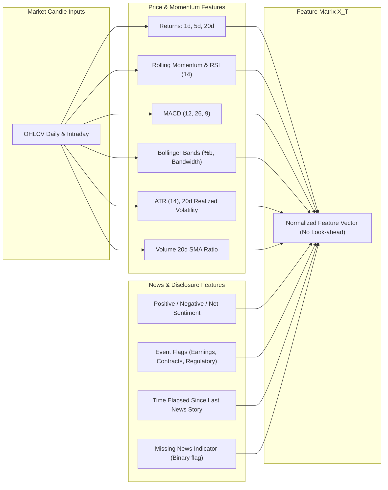

# StockPilot AI — Machine Learning Design & Evaluation Framework

## 1. Quantitative Modeling Objective

StockPilot AI formulates equity prediction as a **probabilistic binary classification task** with secondary expected return regression.

### 1.1 Primary Target Definition
For a stock $i$ at prediction timestamp $T$ (market close of session $t$):
- Let $P_{i, t}$ be the closing price at session $t$.
- Let $P_{i, t+5}$ be the closing price at session $t+5$ (forward 5 trading sessions).

$$\text{forward\_return\_5d} = \frac{P_{i, t+5}}{P_{i, t}} - 1$$

$$\text{target\_up} = \begin{cases} 
1 & \text{if } \text{forward\_return\_5d} > 0 \\ 
0 & \text{otherwise} 
\end{cases}$$

### 1.2 Execution Price Convention
- Forecasts are generated at end-of-day market close $T$.
- Simulated strategy execution assumes entry at the next session's open price ($P_{i, t+1}^{\text{open}}$) or close ($P_{i, t}^{\text{close}}$) with realistic transaction friction (brokerage: 0.03%, exchange turnover fees, STT, and 5 bps estimated slippage).

---

## 2. Feature Engineering Architecture

Features are computed **strictly using information known at or before prediction time $T$**. No future data or expanding windows containing future leaks are allowed.



### Detailed Feature Table
| Feature Group | Name | Description | Lookback |
| :--- | :--- | :--- | :--- |
| **Returns** | `return_1d` | $\ln(P_t / P_{t-1})$ | 1 session |
| | `return_5d` | $\ln(P_t / P_{t-5})$ | 5 sessions |
| | `return_20d` | $\ln(P_t / P_{t-20})$ | 20 sessions |
| **Technical** | `rsi_14` | Relative Strength Index (Wilder's smoothing) | 14 sessions |
| | `macd_hist` | MACD histogram difference | 12/26/9 |
| | `bb_pct_b` | Position within Bollinger Bands: $(P - \text{Lower}) / (\text{Upper} - \text{Lower})$ | 20 sessions, 2$\sigma$ |
| **Volatility** | `atr_14_pct` | Average True Range normalized by close price | 14 sessions |
| | `realized_vol_20d` | Annualized standard deviation of 1d returns | 20 sessions |
| **Volume** | `volume_ratio_20d` | Current volume / 20-day simple moving average volume | 20 sessions |
| **News Sentiment**| `news_sentiment_3d` | Exponentially decaying average sentiment score | 3 calendar days |
| | `news_sentiment_7d` | Moving average sentiment score | 7 calendar days |
| | `news_count_7d` | Total article/disclosure count | 7 calendar days |
| | `news_has_earnings_flag`| Binary flag: 1 if earnings/results filing observed in 7d | 7 calendar days |
| | `news_missing_flag` | Binary flag: 1 if zero news observed in lookback | Lookback window |

---

## 3. Leakage Prevention & Walk-Forward Validation

Cross-validation on financial time series requires strict chronological order. Standard k-fold cross-validation is forbidden because it shuffles samples and causes future information leakage.

### Purged Walk-Forward Cross-Validation
Because the label spans 5 forward sessions ($t \rightarrow t+5$), training samples within 5 days of the test boundary share forward-looking returns.
- **Purging**: Drop training samples whose label overlap with the test set.
- **Embargoing**: Drop training samples immediately after the test window to eliminate autoregressive feature leakage.

```
Split 1: [--- Train 2022-2023 ---] [Purge] [--- Val Q1 2024 ---]
Split 2: [--- Train 2022-Q1 2024 ---] [Purge] [--- Val Q2 2024 ---]
Split 3: [--- Train 2022-Q2 2024 ---] [Purge] [--- Val Q3 2024 ---]
Holdout Test: [--- Test Q4 2024 to present ---]
```

---

## 4. Models Benchmarked

1. **Baseline Model**: Predicts the unconditional historical empirical class frequency:
   $$\hat{P}(\text{Up}) = \frac{1}{N}\sum_{i=1}^{N} y_i$$
2. **Logistic Regression (L2 Regularized)**: Scaled linear baseline providing interpretable log-odds coefficients.
3. **LightGBM Classifier**: Gradient-boosted decision trees with histogram-based splitting, early stopping on validation loss, and depth constraints to prevent overfitting noisy financial data.

---

## 5. Comparative Experiment: Price-Only vs. Price + News

Two parallel pipelines are built and evaluated across identical walk-forward windows:
- **Model A (Price-Only)**: Trained strictly on price, volume, and technical indicators.
- **Model B (Price + News)**: Trained on price, volume, technical indicators, and lag-aligned news sentiment features.

### Evaluation Metrics
| Metric | Purpose |
| :--- | :--- |
| **Brier Score** | Mean squared difference between predicted probability and actual binary outcome $(y \in \{0, 1\})$. Lower is better. |
| **Log Loss (Cross-Entropy)** | Penalizes overconfident wrong predictions. |
| **ROC-AUC** | Evaluates ranking discrimination independent of threshold. |
| **Calibrated Reliability Diagram** | Checks if a predicted probability of 70% corresponds to an actual 70% win rate. |
| **Cost-Adjusted Strategy Sharpe** | Annualized excess return divided by annualized volatility after deducting modeled brokerage and slippage. |

---

## 6. Probability Calibration & Decision Logic

Raw tree probabilities from gradient boosting are frequently uncalibrated near the extremes.
- **Calibration Method**: Isotonic Regression or Platt Scaling (Sigmoidal calibration) fitted on out-of-fold validation predictions.
- **Deterministic Strategy Rules**:
  - `BUY`: $P(\text{Up}) \ge 0.62$ AND expected return $\ge 1.5\%$ AND $ATR < 5\%$ AND data quality is `VERIFIED_FRESH`.
  - `HOLD`: $0.45 \le P(\text{Up}) < 0.62$ OR existing long position with positive thesis.
  - `SELL`: $P(\text{Up}) < 0.40$ OR trailing stop-loss / profit target hit. (Exits long position).
  - `NO TRADE`: Insufficient candle history ($<60$ bars), stale data ($>48$ hours lag), missing model artifact, or extreme volatility regime.
