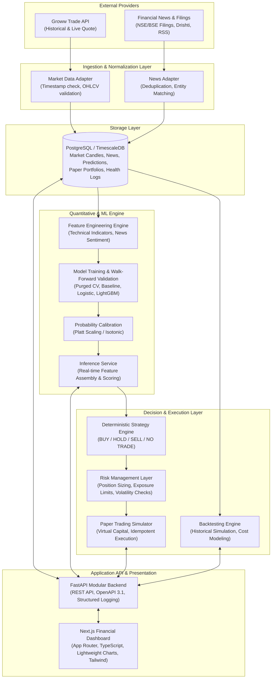

# StockPilot AI — System Design & Architecture

## 1. Executive Summary & Objective

**StockPilot AI** is a production-grade, AI-powered quantitative research, equity analysis, and paper-trading platform focusing on Indian equities listed on the National Stock Exchange (NSE) and Bombay Stock Exchange (BSE).

### Core Principle
> **Machine learning generates numerical forecasts and calibrated probabilities. Language models (LLMs), if utilized, summarize factual evidence, explain rationale, and cite verified sources, but never fabricate market figures, hallucinate indicators, or independently generate trades.**

The platform addresses a major gap in retail and semi-institutional algorithmic trading in India: bridging verified market-data pipelines (Groww Trade API), structured financial news/regulatory disclosures (corporate filings, earnings transcripts, news feeds), rigorous walk-forward machine learning models, deterministic strategy/risk filters, backtesting, and virtual paper execution without risking real capital.

---

## 2. High-Level System Architecture

StockPilot AI is designed as a **modular monolith** with clean service boundaries, enabling lightweight deployment for local development while remaining directly splitable into independent microservices as ingestion volume scales.

---

## 3. Data Flow & Processing Lifecycle

1. **Market Data Pipeline**:
   - Ingests daily and intraday candles via Groww Trade API REST endpoint `/v1/historical/candle/range` (or `/v1/historical/candles`).
   - Normalizes into unified `market_candles` schema (UTC timestamps, verified High >= Max(Open, Close), Low <= Min(Open, Close), Volume >= 0).
   - Ingests live quote snapshots via `/v1/live-data/quote` for real-time dashboard updates.

2. **News & Disclosures Pipeline**:
   - Ingests news items and corporate announcements from verified providers (Drishti API, exchange feeds, financial news feeds).
   - Extracts company entities, deduplicates syndicated wires, and records `published_at` vs. `first_seen_at` (preserving auditability and preventing look-ahead bias).
   - Performs NLP sentiment scoring and event categorization (earnings, management change, regulatory action, contract win).

3. **Feature Store & Dataset Generation**:
   - Merges market candles with lag-aligned news sentiment features strictly before the prediction timestamp ($T$).
   - Calculates momentum, rolling volatility, RSI, MACD, and sentiment momentum over multiple lookback windows (1d, 5d, 20d).
   - Target definition: Binary classification for 5-day forward return:
     $$\text{forward\_return\_5d} = \frac{P_{T+5}}{P_{T}} - 1, \quad \text{target} = \mathbb{I}(\text{forward\_return\_5d} > 0)$$

4. **Inference & Strategy Evaluation**:
   - Model outputs uncalibrated score $\rightarrow$ Calibrated probability $P(\text{Up})$.
   - Deterministic Strategy Evaluator checks thresholds, data freshness, market regime, and risk factors.
   - Outputs structured prediction: `BUY`, `HOLD`, `SELL`, or `NO TRADE`.

5. **Paper Trading & Risk Management**:
   - Virtual accounts execute simulated orders with configurable slippage (e.g. 5 bps) and brokerage fees (e.g. 0.03% or ₹20/order).
   - Idempotent order placement preventing duplicate fills.

---

## 4. Subsystem Breakdown

### 4.1 Frontend (`apps/web`)
- **Framework**: Next.js 15+ (React 19, TypeScript in strict mode).
- **Styling**: Tailwind CSS, custom financial palette (dark theme by default, charcoal neutral backgrounds, muted greens and reds for price action).
- **Visualization**: Interactive Candlestick charts, Equity curves, and Distribution histograms.
- **State Management**: TanStack Query (React Query) for caching, optimistic updates, and background refetching.

### 4.2 Backend API (`services/api`)
- **Framework**: FastAPI (Python 3.11+ / 3.14).
- **Data Validation**: Pydantic v2 with strict schemas.
- **ORM / Persistence**: SQLAlchemy 2.0 with async engine and Alembic migrations.
- **Security**: CORS restrictions, API key auth for private endpoints, strict parameter validation.
- **Documentation**: Interactive Swagger UI (`/docs`) and ReDoc (`/redoc`).

### 4.3 Machine Learning Pipeline (`services/ml`)
- **Data Preprocessing**: Pandas 2.x, NumPy.
- **Modeling**: scikit-learn (baseline & logistic regression), LightGBM (gradient boosted trees).
- **Calibration**: Isotonic Regression / Platt Scaling on out-of-fold validation splits.
- **Validation**: Walk-forward cross-validation with purging and embargo periods to eliminate temporal leakage.
- **Explainability**: SHAP (TreeSHAP) feature attribution for prediction drivers.

### 4.4 Simulation Engines (`services/api/app/services/backtesting` & `paper`)
- **Backtesting Engine**: Event-driven historical bar replay, tracking portfolio cash, holdings, transaction fees, and calculating Sharpe, Sortino, Max Drawdown, and Win Rate.
- **Paper Trading Engine**: Virtual portfolio tracking open positions, realized/unrealized P&L, margin requirements, and trade histories.

---

## 5. Technology Stack Decisions & Justifications

| Component | Technology | Rationale |
| :--- | :--- | :--- |
| **Frontend Framework** | Next.js (App Router) + TS | Server Components for speed, strict typing, standard React ecosystem. |
| **Component Library** | Tailwind CSS + Lucide Icons | Clean financial aesthetics, complete design control without bloated UI dependencies. |
| **API Framework** | FastAPI | High throughput, native async support, automatic OpenAPI 3.1 documentation, tight Pydantic integration. |
| **Primary Database** | PostgreSQL | Proven ACID reliability, native JSONB support, timescale extension compatibility, robust indexing. |
| **ML Framework** | scikit-learn + LightGBM | High execution speed, strong tabular data performance, low latency inference, interpretable feature importance. |
| **Local Containerization**| Docker & Docker Compose | Uniform local developer environment across Windows/macOS/Linux. |

---

## 6. Integration Contracts & Boundaries

1. **Groww Adapter**:
   - Input: Exchange (`NSE`), Segment (`CASH`), Trading Symbol (`TCS`, `INFY`), Interval (`1440` or `5`), Date Range.
   - Output: Normalized `MarketCandle` objects.
   - Fallback: Graceful degradation to verified mock/sample data when `GROWW_ACCESS_TOKEN` is unset or invalid, explicitly flagged as `is_demo: true`.

2. **News Adapter**:
   - Input: Company identifier, ticker, lookback days.
   - Output: Normalized `NewsArticle` objects with timestamp provenance (`published_at`, `ingested_at`).
   - Fallback: Transparent feed health status: `HEALTHY`, `STALE`, or `UNAVAILABLE`. Never inject pseudo-neutral sentiment when data is absent.

3. **Inference Contract**:
   - Every inference response includes: `model_version`, `as_of`, `forecast_horizon`, `probability_up`, `probability_down`, `signal`, `risk_level`, `supporting_factors`, `contradicting_factors`, and `data_quality_status`.
